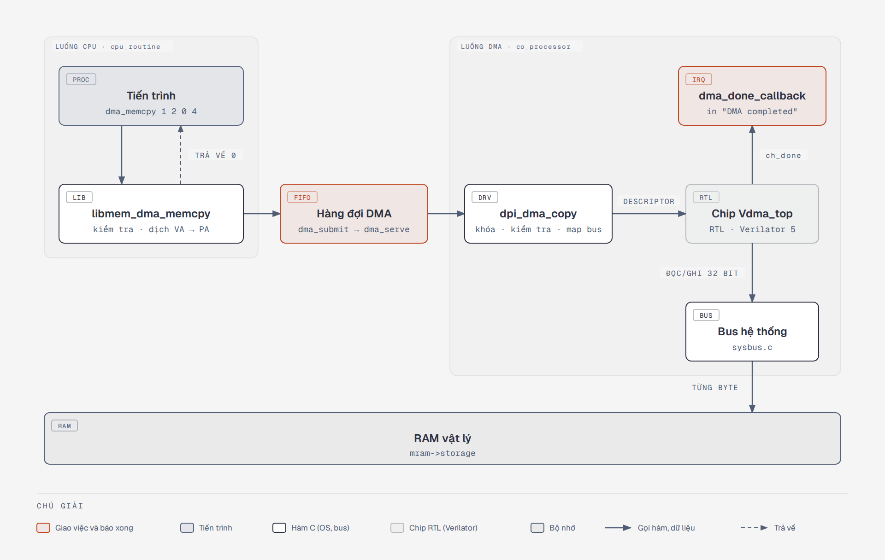

# BÁO CÁO BÀI TẬP LỚN MÔN HỆ ĐIỀU HÀNH (CO2018)
## Đề tài: Mô phỏng Hệ điều hành Đơn giản với Bộ đồng xử lý DMA (`demacOprx`)

**Học kỳ:** HK261  
**Nhóm:** Group 07  
**Giảng viên hướng dẫn:** PGS.TS. Nguyễn Tiến Dũng (pdnguyen)

---

## Danh sách Thành viên & Phân công Nhiệm vụ

| STT | Họ và Tên | MSSV | Email | Mã việc | Nhiệm vụ chính (Code & Báo cáo) |
| :-: | :--- | :---: | :--- | :---: | :--- |
| 1 | **Nguyễn Khắc Triệu** | 2213619 | trieu.nguyenkhac@hcmut.edu.vn | **A1, B1** | Bộ lập lịch MLQ & Queue (`queue.c`, `sched.c`); Biểu đồ Gantt, Câu hỏi 3, Khung báo cáo chung |
| 2 | **Phạm Huỳnh Trọng Trí** | 2213657 | tri.phamhuynhtrong@hcmut.edu.vn | **A2, B2** | Syscall `memmap` & MM-VM (`sys_mem.c`, `mm-vm.c`, `mm.h`); Cơ chế PID Passing, Câu hỏi 1 & 2 |
| 3 | **Trịnh Thanh Quang** | 2412862 | quang.trinhthanhcse@hcmut.edu.vn | **A3, B3** | Bộ nhớ vật lý & Phân trang 64-bit 5 cấp (`mm-memphy.c`, `mm64.c`); Sơ đồ 5 cấp, Câu hỏi 4, 5 & 6 |
| 4 | **Đặng Hồng Anh** | 2410060 | anh.dang2502@hcmut.edu.vn | **A4, B4** | Thư viện `libmem` User-space & Thay trang FIFO (`libmem.c`); Sơ đồ Data Segment, Swap, Câu hỏi 7 |
| 5 | **Nguyễn Hoàng Quốc Mạnh** | 2111721 | manh.nguyenrynaster01@hcmut.edu.vn | **A5, B5** | Bộ nhớ nhân (`kmalloc`) & Copy User/Kernel (`libmem.c`, `os.c`); Tách không gian User/Kernel, Đồng bộ `kmem` |
| 6 | **Trần Khan** | 2510102 | khan.tran1507@hcmut.edu.vn | **A6, B6** | Bộ đồng xử lý DMA & Bus (`libmem.c`: `libmem_dma_memcpy`, `os.c`, `dma_c_testbench.cpp`, `sysbus.c`, `dpi_rtl.cpp`); Bất đồng bộ DMA, Bus Addressing |

---

## Mục lục
1. [Phần 1 (B1): Bộ lập lịch Đa hàng đợi (MLQ Scheduler)](#phần-1-b1-bộ-lập-lịch-đa-hàng-đợi-mlq-scheduler)
   - [1.1. Thiết kế và Hiện thực Hàng đợi (`queue.c`) và Bộ lập lịch (`sched.c`)](#11-thiết-kế-và-hiện-thực-hàng-đợi-queuec-và-bộ-lập-lịch-schedc)
   - [1.2. Biểu đồ Gantt và Phân tích Kết quả Kiểm thử (`sched`, `sched_0`, `sched_1`)](#12-biểu-đồ-gantt-và-phân-tích-kết-quả-kiểm-thử-sched-sched_0-sched_1)
   - [1.3. Trả lời Câu hỏi 3 (Mục 2.1): Lợi ích chính sách MLQ và Chống đói tài nguyên](#13-trả-lời-câu-hỏi-3-mục-21-lợi-ích-chính-sách-mlq-và-chống-đói-tài-nguyên)
2. [Phần 2 (B2): Giao diện Lời gọi Hệ thống (System Call) & Vùng nhớ ảo (MM-VM)](#phần-2-b2-giao-diện-lời-gọi-hệ-thống-system-call--vùng-nhớ-ảo-mm-vm)
   - [2.1. Sơ đồ Luồng System Call và Cơ chế Bảo mật PID Passing](#21-sơ-đồ-luồng-system-call-và-cơ-chế-bảo-mật-pid-passing)
   - [2.2. Trả lời Câu hỏi 1 (Trang 9): Giao diện System Call thống nhất](#22-trả-lời-câu-hỏi-1-trang-9-giao-diện-system-call-thống-nhất)
   - [2.3. Trả lời Câu hỏi 2 (Trang 11): Xử lý System Call thực thi quá lâu](#23-trả-lời-câu-hỏi-2-trang-11-xử-lý-system-call-thực-thi-quá-lâu)
3. [Phần 3 (B3): Bộ nhớ Vật lý & Phân trang Đa cấp 64-bit (5-level Paging)](#phần-3-b3-bộ-nhớ-vật-lý--phân-trang-đa-cấp-64-bit-5-level-paging)
   - [3.1. Sơ đồ Dịch địa chỉ Phân trang 5 cấp (57-bit Virtual Address)](#31-sơ-đồ-dịch-địa-chỉ-phân-trang-5-cấp-57-bit-virtual-address)
   - [3.2. Thống kê Truy cập Bộ nhớ và Dung lượng Bảng trang](#32-thống-kê-truy-cập-bộ-nhớ-và-dung-lượng-bảng-trang)
   - [3.3. Trả lời Câu hỏi 4, 5, 6](#33-trả-lời-câu-hỏi-4-5-6)
4. [Phần 4 (B4): Quản lý Vùng nhớ User-space, Hoán đổi trang (Swapping) & Đồng bộ hóa](#phần-4-b4-quản-lý-vùng-nhớ-user-space-hoán-đổi-trang-swapping--đồng-bộ-hóa)
   - [4.1. Sơ đồ Trạng thái Cấp phát Bộ nhớ trong Data Segment](#41-sơ-đồ-trạng-thái-cấp-phát-bộ-nhớ-trong-data-segment)
   - [4.2. Cơ chế Thay thế trang FIFO và Hoán đổi RAM/SWAP](#42-cơ-chế-thay-thế-trang-fifo-và-hoán-đổi-ramswap)
   - [4.3. Trả lời Câu hỏi 7 (Trang 25): Đồng bộ hóa và Điều kiện Tranh chấp (Race Condition)](#43-trả-lời-câu-hỏi-7-trang-25-đồng-bộ-hóa-và-điều-kiện-tranh-chấp-race-condition)
5. [Phần 5 (B5): Phân tách Không gian Nhớ User/Kernel & Quản lý Bộ nhớ Nhân (`kmem`)](#phần-5-b5-phân-tách-không-gian-nhớ-userkernel--quản-lý-bộ-nhớ-nhân-kmem)
   - [5.1. Cơ chế Phân tách Địa chỉ Chuẩn tắc (Canonical Address) và Bảo vệ Bộ nhớ Nhân](#51-cơ-chế-phân-tách-địa-chỉ-chuẩn-tắc-canonical-address-và-bảo-vệ-bộ-nhớ-nhân)
   - [5.2. Cấp phát Bộ nhớ Nhân liên tục (`__kmalloc`) và Sao chép `copy_from_user` / `copy_to_user`](#52-cấp-phát-bộ-nhớ-nhân-liên-tục-__kmalloc-và-sao-chép-copy_from_user--copy_to_user)
6. [Phần 6 (B6): Bộ đồng xử lý DMA (Verilator RTL) & Định địa chỉ Bus](#phần-6-b6-bộ-đồng-xử-lý-dma-verilator-rtl--định-địa-chỉ-bus)
   - [6.1. Cơ chế Hoạt động Bất đồng bộ (Asynchronous Operation) giữa CPU và DMA](#61-cơ-chế-hoạt-động-bất-đồng-bộ-asynchronous-operation-giữa-cpu-và-dma)
   - [6.2. Định địa chỉ Bus (Bus Addressing): CPU qua MMU vs. DMA truy cập trực tiếp RAM](#62-định-địa-chỉ-bus-bus-addressing-cpu-qua-mmu-vs-dma-truy-cập-trực-tiếp-ram)

---

## Phần 1 (B1): Bộ lập lịch Đa hàng đợi (MLQ Scheduler)
*(Phụ trách: Nguyễn Khắc Triệu - MSSV: 2213619)*

### 1.1. Thiết kế và Hiện thực Hàng đợi (`queue.c`) và Bộ lập lịch (`sched.c`)

#### a) Hiện thực cấu trúc hàng đợi FIFO (`src/queue.c`)
Mỗi hàng đợi `struct queue_t` quản lý một mảng tĩnh tối đa `MAX_QUEUE_SIZE = 50` con trỏ `struct pcb_t *` và biến `size` lưu số lượng tiến trình hiện tại. Vì trong kiến trúc MLQ, mỗi mức độ ưu tiên `prio` (từ `0` đến `MAX_PRIO - 1`) đã có một hàng đợi riêng biệt `mlq_ready_queue[prio]`, nên các tiến trình nằm trong cùng một hàng đợi có cùng độ ưu tiên và được phục vụ theo nguyên tắc **FIFO (First-In, First-Out)**:
- **`enqueue(struct queue_t *q, struct pcb_t *proc)`**: Kiểm tra tính hợp lệ (`q != NULL`, `proc != NULL`) và nếu `q->size < MAX_QUEUE_SIZE` thì chèn `proc` vào cuối mảng tại vị trí `q->proc[q->size]`, sau đó tăng `q->size++`.
- **`dequeue(struct queue_t *q)`**: Kiểm tra hàng đợi khác rỗng (`q->size > 0`), lấy phần tử đầu tiên `q->proc[0]` ra để trả về, sau đó dùng vòng lặp `for` dịch chuyển toàn bộ các phần tử từ vị trí `1 .. q->size - 1` sang trái 1 ô và giảm `q->size--`.
- **`purgequeue(struct queue_t *q, struct pcb_t *proc)`**: Duyệt mảng tìm phần tử khớp với con trỏ `proc`. Khi tìm thấy tại chỉ số `i`, lưu lại con trỏ, dịch các phần tử phía sau lên 1 vị trí để lấp chỗ trống, giảm `q->size--` và trả về `proc` vừa xóa. Hàm này được dùng để rút tiến trình ra khỏi `running_list` khi tiến trình hết lượt chạy (time slice) hoặc kết thúc.

#### b) Hiện thực Bộ lập lịch Đa hàng đợi MLQ (`src/sched.c`)
Hệ thống hỗ trợ `MAX_PRIO = 140` mức ưu tiên (từ `0` đến `139`, giá trị số càng nhỏ độ ưu tiên càng cao):
- **`init_scheduler()`**: Khởi tạo toàn bộ 140 hàng đợi `mlq_ready_queue[i].size = 0`, khởi tạo định mức khe thời gian (slot) cho từng mức ưu tiên theo công thức `slot[i] = MAX_PRIO - i`, làm rỗng `running_list` và khởi tạo khóa `pthread_mutex_init(&queue_lock, NULL)`.
- **`get_mlq_proc()`**:
  1. Khóa `queue_lock` để đảm bảo an toàn đa luồng khi nhiều CPU cùng lấy tiến trình.
  2. Quét từ mức ưu tiên cao nhất `i = 0` đến `MAX_PRIO - 1`. Nếu hàng đợi `mlq_ready_queue[i]` không rỗng (`!empty(...)`) thì ghi nhận `has_proc = 1`. Nếu đồng thời `slot[i] > 0`, gọi `dequeue(&mlq_ready_queue[i])`, giảm `slot[i]--` và thoát vòng lặp.
  3. Nếu duyệt hết cả 140 mức ưu tiên mà chưa lấy được tiến trình (`proc == NULL`) nhưng vẫn còn tiến trình đang chờ (`has_proc == 1`, tức các hàng đợi có tiến trình đều đã cạn `slot[i] == 0`), bộ lập lịch thực hiện **cấp phát lại (reset) toàn bộ mảng `slot[i] = MAX_PRIO - i`** rồi quét lại từ đầu để lấy tiến trình.
  4. Nếu lấy được `proc != NULL`, đưa tiến trình vào `running_list` bằng `enqueue(&running_list, proc)`, mở khóa `queue_lock` và trả về `proc`.
- **`put_mlq_proc()` và `add_mlq_proc()`**: Bảo vệ bằng `queue_lock`, gỡ tiến trình khỏi `running_list` (khi `put_mlq_proc`) và đưa tiến trình vào cuối hàng đợi `mlq_ready_queue[proc->prio]`.

---

### 1.2. Biểu đồ Gantt và Phân tích Kết quả Kiểm thử (`sched`, `sched_0`, `sched_1`)

#### 1.2.0. Bảng quy định định mức khe thời gian (`slot`) theo độ ưu tiên (`priority`)
Trong bộ lập lịch MLQ (`MAX_PRIO = 140`, cấu hình tại `include/os-cfg.h`), mỗi mức ưu tiên `prio` $\in [0, 139]$ được khởi tạo định mức số lượt lấy tiến trình (`slot[prio]`) trong một chu kỳ lập lịch theo công thức:
$$\text{slot}[\text{prio}] = \text{MAX\_PRIO} - \text{prio} = 140 - \text{prio}$$
Mỗi lần một tiến trình ở hàng đợi `mlq_ready_queue[prio]` được hàm `get_mlq_proc()` lấy ra cấp cho CPU (và chạy tối đa `time_slice` đơn vị thời gian), giá trị `slot[prio]` giảm đi `1`.

| Mức độ ưu tiên (`prio`) | Hàng đợi tương ứng | Định mức `slot` ban đầu (`140 - prio`) | Thời gian CPU tối đa / chu kỳ (`slot` $\times$ `time_slice`) | Các kịch bản kiểm thử sử dụng mức `prio` này |
| :-: | :---: | :-: | :---: | :--- |
| **`0`** *(Cao nhất)* | `mlq_ready_queue[0]` | **140** | $140 \times \text{time\_slice}$ | `sched` (P1, P4), `sched_0` (P3, P4), `sched_1` (P2, P3, P4, P5) |
| **`1`** | `mlq_ready_queue[1]` | **139** | $139 \times \text{time\_slice}$ | `sched` (P2, P3) |
| **`2`** | `mlq_ready_queue[2]` | **138** | $138 \times \text{time\_slice}$ | - |
| **`3`** | `mlq_ready_queue[3]` | **137** | $137 \times \text{time\_slice}$ | - |
| **`4`** | `mlq_ready_queue[4]` | **136** | $136 \times \text{time\_slice}$ | `sched_0` (P1, P2), `sched_1` (P1) |
| $\dots$ | $\dots$ | $\dots$ | $\dots$ | $\dots$ |
| **`15`** | `mlq_ready_queue[15]` | **125** | $125 \times \text{time\_slice}$ | `os_0_mlq_paging`, `os_1_mlq_paging`, `os_2_mlq_paging` |
| **`38`** | `mlq_ready_queue[38]` | **102** | $102 \times \text{time\_slice}$ | `os_1_mlq_paging`, `os_2_mlq_paging` |
| **`39`** | `mlq_ready_queue[39]` | **101** | $101 \times \text{time\_slice}$ | `os_1_mlq_paging`, `os_2_mlq_paging` |
| **`120`** | `mlq_ready_queue[120]` | **20** | $20 \times \text{time\_slice}$ | `os_1_mlq_paging`, `os_2_mlq_paging` |
| **`130`** | `mlq_ready_queue[130]` | **10** | $10 \times \text{time\_slice}$ | `os_1_mlq_paging` |
| **`139`** *(Thấp nhất)* | `mlq_ready_queue[139]` | **1** | $1 \times \text{time\_slice}$ | - |

---

#### 1.2.1. Kịch bản kiểm thử 1: `input/sched` (Đa CPU: 2 CPU, Time slice = 4)

**Cấu hình đầu vào (`input/sched`):**
- `time_slice = 4`, `num_cpus = 2`, `num_processes = 4`
- Danh sách tiến trình nạp vào và biến thiên `slot` theo `prio`:

| PID | Chương trình | Thời điểm nạp (`start_time`) | Số lệnh (`size` - toàn bộ `calc`) | Độ ưu tiên (`prio`) | `slot[prio]` ban đầu | Số lần Dispatch thực tế | `slot[prio]` còn lại sau khi chạy xong |
| :-: | :---: | :-: | :-: | :-: | :-: | :-: | :-: |
| **P1** | `p2s` | Slot 0 | 12 | 0 | 140 | 3 lần (CPU 1: 1, CPU 0: 2) | $140 - (3 + 5) = \mathbf{132}$ *(dùng chung `slot[0]` với P4)* |
| **P2** | `p1s` | Slot 1 | 10 | 1 | 139 | 5 lần (CPU 0: 5) | $139 - (5 + 3) = \mathbf{131}$ *(dùng chung `slot[1]` với P3)* |
| **P3** | `p2s` | Slot 3 | 12 | 1 | 139 | 3 lần (CPU 0: 1, CPU 1: 2) | **131** *(cùng mức `prio = 1`)* |
| **P4** | `p3s` | Slot 4 | 11 | 0 | 140 | 5 lần (CPU 1: 5) | **132** *(cùng mức `prio = 0`)* |

**Bảng trung gian theo dõi trạng thái lập lịch và `slot` (`output/sched.output`):**

| Time Slot | Sự kiện Loader (`ld_routine`) | Hoạt động trên **CPU 1** | Hoạt động trên **CPU 0** | Hàng đợi `prio = 0` & `slot[0]` | Hàng đợi `prio = 1` & `slot[1]` |
| :-: | :--- | :--- | :--- | :---: | :---: |
| **0** | Load **P1** (`prio=0`) | *(Chưa lấy được proc)* | *(Chưa lấy được proc)* | `[P1]` (`slot=140`) | `[]` (`slot=139`) |
| **1** | Load **P2** (`prio=1`) | **Dispatch P1** (chạy 1/12) | *(Chờ tới slot sau)* | `[]` (`slot=139`) | `[P2]` (`slot=139`) |
| **2** | - | Chạy P1 (2/12) | **Dispatch P2** (chạy 1/10) | `[]` (`slot=139`) | `[]` (`slot=138`) |
| **3** | Load **P3** (`prio=1`) | Chạy P1 (3/12) | Chạy P2 (2/10) | `[]` (`slot=139`) | `[P3]` (`slot=138`) |
| **4** | Load **P4** (`prio=0`) | Chạy P1 (4/12) | Chạy P2 (3/10) | `[P4]` (`slot=139`) | `[P3]` (`slot=138`) |
| **5** | *(Done)* | Put P1 $\rightarrow$ **Dispatch P4** (1/11) | Chạy P2 (4/10) | `[P1]` (`slot=138`) | `[P3]` (`slot=138`) |
| **6..8** | - | Chạy P4 (2..4/11) | Slot 6: Put P2 $\rightarrow$ **Dispatch P1** (5..7/12) | `[]` (`slot=137`) | `[P3, P2]` (`slot=138`) |
| **9** | - | Put P4 $\rightarrow$ **Dispatch P4** (5/11) | Chạy P1 (8/12) | `[]` (`slot=136`) | `[P3, P2]` (`slot=138`) |
| **10..12** | - | Chạy P4 (6..8/11) | Slot 10: Put P1 $\rightarrow$ **Dispatch P1** (9..11/12) | `[]` (`slot=135`) | `[P3, P2]` (`slot=138`) |
| **13** | - | Put P4 $\rightarrow$ **Dispatch P4** (9/11) | Chạy P1 (12/12) | `[]` (`slot=134`) | `[P3, P2]` (`slot=138`) |
| **14..16** | - | Chạy P4 (10..11/11) | Slot 14: **P1 Finished** $\rightarrow$ **Dispatch P3** (1..3/12) | `[]` (`slot=134`) | `[P2]` (`slot=137`) |
| **17** | - | Put P4 $\rightarrow$ **Dispatch P4** *(pc==size)* | Chạy P3 (4/12) | `[]` (`slot=133`) | `[P2]` (`slot=137`) |
| **18..20** | - | Chờ hết time_slice của P4 | Slot 18: Put P3 $\rightarrow$ **Dispatch P2** (5..7/10) | `[]` (`slot=133`) | `[P3]` (`slot=136`) |
| **21** | - | Put P4 $\rightarrow$ **Dispatch P4** | Chạy P2 (8/10) | `[]` (`slot=132`) | `[P3]` (`slot=136`) |
| **22..25** | - | Slot 22: **P4 Finished** $\rightarrow$ **Dispatch P3** (5..8/12) | Slot 22: Put P2 $\rightarrow$ **Dispatch P2** (9..10/10) | `[]` (`slot=132`) | `[]` (`slot=134`) |
| **26..29** | - | Slot 26: Put P3 $\rightarrow$ **Dispatch P3** (9..12/12) | Slot 26: Put P2 $\rightarrow$ **Dispatch P2** | `[]` (`slot=132`) | `[]` (`slot=132`) |
| **30..32** | - | Slot 30: **P3 Finished**, **CPU 1 Stopped** | Slot 30: Put P2 $\rightarrow$ **Dispatch P2** | `[]` (`slot=132`) | `[]` (`slot=131`) |
| **33** | - | *(Stopped)* | **P2 Finished**, **CPU 0 Stopped** | `[]` (`slot=132`) | `[]` (`slot=131`) |

**Biểu đồ Gantt (Kịch bản `sched` - 2 CPU):**

```text
Time Slot:  0  1  2  3  4  5  6  7  8  9 10 11 12 13 14 15 16 17 18 19 20 21 22 23 24 25 26 27 28 29 30 31 32 33
           +--+-----------+-----------+-----------+-----------+-----------+--+-----------+-----------+
CPU 1:     |  |    P1     |    P4     |    P4     |    P4     |    P4     |P4|    P3     |    P3     | (Stop at 30)
           +--+-----------+-----------+-----------+-----------+-----------+--+-----------+-----------+
           +-----+-----------+-----------+-----------+-----------+-----------+-----------+-----------+--------+
CPU 0:     |     |    P2     |    P1     |    P1     |    P3     |    P2     |    P2     |    P2     |   P2   | (Stop at 33)
           +-----+-----------+-----------+-----------+-----------+-----------+-----------+-----------+--------+
```

**Giải thích thứ tự chạy:**
- Tại Slot 1 và 2: P1 (`prio=0`) được cấp cho CPU 1 (`slot[0]` giảm từ 140 xuống 139), P2 (`prio=1`) được cấp cho CPU 0 (`slot[1]` giảm từ 139 xuống 138) vì lúc đó hàng đợi `prio=0` đã trống.
- Tại Slot 5: P1 hết `time_slice = 4`, trả về hàng đợi `prio=0` sau P4 (vừa vào lúc Slot 4). Do đó CPU 1 lấy P4 ra chạy (`slot[0]` giảm còn 138).
- Tại Slot 6: P2 hết `time_slice = 4`, trả về hàng đợi `prio=1`. Khi CPU 0 gọi `get_proc()`, vì hàng đợi `prio=0` đang có P1 (ưu tiên cao hơn `prio=1` và `slot[0] = 138 > 0`), CPU 0 lập tức lấy P1 ra chạy thay vì chạy tiếp P3 hay P2.
- Chỉ khi cả P1 và P4 (thuộc `prio=0`) đã được lấy hết hoặc hoàn thành (từ Slot 14 trên CPU 0 và Slot 22 trên CPU 1), CPU 0 và CPU 1 mới quay xuống phục vụ P3 và P2 ở hàng đợi `prio=1`.

---

#### 1.2.2. Kịch bản kiểm thử 2: `input/sched_0` (1 CPU, Time slice = 2)

**Cấu hình đầu vào (`input/sched_0`):**
- `time_slice = 2`, `num_cpus = 1`, `num_processes = 4`
- Danh sách tiến trình và thống kê `slot` theo `priority`:

| PID | Chương trình | Thời điểm nạp (`start_time`) | Số lệnh (`size`) | Độ ưu tiên (`prio`) | `slot[prio]` ban đầu | Số lần Dispatch | `slot[prio]` còn lại khi kết thúc |
| :-: | :---: | :-: | :-: | :-: | :-: | :-: | :-: |
| **P1** | `s0` | Slot 0 | 15 | 4 | 136 | 8 lần | $136 - (8 + 8) = \mathbf{120}$ *(dùng chung `slot[4]` với P2)* |
| **P2** | `s0` | Slot 1 | 15 | 4 | 136 | 8 lần | **120** *(cùng mức `prio = 4`)* |
| **P3** | `s1` | Slot 4 | 7 | 0 | 140 | 4 lần | $140 - (4 + 8) = \mathbf{128}$ *(dùng chung `slot[0]` với P4)* |
| **P4** | `s0` | Slot 5 | 15 | 0 | 140 | 8 lần | **128** *(cùng mức `prio = 0`)* |

**Bảng trung gian theo dõi trạng thái lập lịch và `slot` (`output/sched_0.output`):**

| Giai đoạn (Time Slot) | Sự kiện Loader / Hoàn thành | Tiến trình được Dispatch trên **CPU 0** | Hàng đợi `prio = 0` & `slot[0]` | Hàng đợi `prio = 4` & `slot[4]` |
| :---: | :--- | :--- | :---: | :---: |
| **0** | Load **P1** (`prio=4`) | *(Chờ)* | `[]` (`140`) | `[P1]` (`136`) |
| **1..2** | Slot 1: Load **P2** (`prio=4`) | **Dispatch P1** (chạy 2 lệnh) | `[]` (`140`) | `[P2]` (`135`) |
| **3..4** | Slot 4: Load **P3** (`prio=0`) | Put P1 $\rightarrow$ **Dispatch P2** (chạy 2 lệnh) | `[P3]` (`140`) | `[P1]` (`134`) |
| **5..6** | Slot 5: Load **P4** (`prio=0`) | Put P2 $\rightarrow$ **Dispatch P3** (ưu tiên `prio=0`) | `[P4]` (`139`) | `[P1, P2]` (`134`) |
| **7..21** | - | Luân phiên Round-Robin **P4 $\leftrightarrow$ P3** (`time_slice=2`):<br>P4 (7..8), P3 (9..10), P4 (11..12), P3 (13..14), P4 (15..16), P3 (17..18), P4 (19..20), P3 (21) | Cuối Slot 21:<br>`[P4]` (`132`) | `[P1, P2]` (`134`) |
| **22..28** | Slot 22: **P3 Finished** | **P4** chạy liên tục 4 lượt cuối: (22..23), (24..25), (26..27), (28) | `[]` (`128`) | `[P1, P2]` (`134`) |
| **29..53** | Slot 29: **P4 Finished** | Hàng đợi `prio=0` rỗng $\rightarrow$ Luân phiên **P1 $\leftrightarrow$ P2** ở `prio=4`:<br>P1 (29..30), P2 (31..32), ..., P2 (51..52), P1 (53) | `[]` (`128`) | Cuối Slot 53:<br>`[P2]` (`121`) |
| **54..55** | Slot 54: **P1 Finished**<br>Slot 55: **P2 Finished** | Slot 54: **Dispatch P2** (chạy lệnh cuối) $\rightarrow$ Slot 55: **CPU 0 Stopped** | `[]` (`128`) | `[]` (`120`) |

**Biểu đồ Gantt (Kịch bản `sched_0` - 1 CPU):**

```text
Slot:   0  1  3  5  7  9 11 13 15 17 19 21 22 24 26 28 29 31 33 35 37 39 41 43 45 47 49 51 53 54 55
       +--+--+--+--+--+--+--+--+--+--+--+--+--+--+--+--+--+--+--+--+--+--+--+--+--+--+--+--+--+--+--+
CPU 0: |  |P1|P2|P3|P4|P3|P4|P3|P4|P3|P4|P3|P4|P4|P4|P4|P1|P2|P1|P2|P1|P2|P1|P2|P1|P2|P1|P2|P1|P2|Stop
       +--+--+--+--+--+--+--+--+--+--+--+--+--+--+--+--+--+--+--+--+--+--+--+--+--+--+--+--+--+--+--+
```

**Giải thích:**
- Từ Slot 1 đến Slot 5: Chỉ có P1 và P2 (`prio=4`), CPU 0 chạy lần lượt P1 (Slot 1-2) và P2 (Slot 3-4), tiêu thụ 2 slot của mức `prio=4` (`slot[4]` giảm từ 136 xuống 134).
- Tại Slot 4 và 5: P3 và P4 xuất hiện với độ ưu tiên cao nhất (`prio=0`). Do đó từ Slot 5 đến Slot 29, P3 và P4 chiếm quyền ưu tiên trên CPU 0, luân phiên nhau theo Round-Robin (`time_slice = 2`) cho đến khi P3 kết thúc ở Slot 22 và P4 kết thúc ở Slot 29 (tiêu thụ 12 slot của mức `prio=0`, `slot[0]` còn 128).
- Từ Slot 29 đến Slot 55: Hàng đợi `prio=0` đã trống hoàn toàn, P1 và P2 ở `prio=4` mới tiếp tục luân phiên nhau chạy cho đến khi kết thúc ở Slot 54 (P1) và Slot 55 (P2).

---

#### 1.2.3. Kịch bản kiểm thử 3: `input/sched_1` (1 CPU, Time slice = 2)

**Cấu hình đầu vào (`input/sched_1`):**
- `time_slice = 2`, `num_cpus = 1`, `num_processes = 5`
- Danh sách tiến trình và thống kê `slot` theo `priority`:

| PID | Chương trình | Thời điểm nạp (`start_time`) | Số lệnh (`size`) | Độ ưu tiên (`prio`) | `slot[prio]` ban đầu | Số lần Dispatch | `slot[prio]` còn lại khi kết thúc |
| :-: | :---: | :-: | :-: | :-: | :-: | :-: | :-: |
| **P1** | `s0` | Slot 0 | 15 | 4 | 136 | 8 lần | $136 - 8 = \mathbf{128}$ |
| **P2** | `s3` | Slot 2 | 11 | 0 | 140 | 6 lần | $140 - (6+6+4+6) = \mathbf{118}$ *(chung `slot[0]`)* |
| **P3** | `s2` | Slot 3 | 12 | 0 | 140 | 6 lần | **118** *(cùng mức `prio = 0`)* |
| **P4** | `s1` | Slot 5 | 7 | 0 | 140 | 4 lần | **118** *(cùng mức `prio = 0`)* |
| **P5** | `s3` | Slot 6 | 11 | 0 | 140 | 6 lần | **118** *(cùng mức `prio = 0`)* |

**Bảng trung gian theo dõi trạng thái lập lịch và `slot` (`output/sched_1.output`):**

| Giai đoạn (Time Slot) | Sự kiện Loader / Hoàn thành | Tiến trình được Dispatch trên **CPU 0** | Hàng đợi `prio = 0` & `slot[0]` | Hàng đợi `prio = 4` & `slot[4]` |
| :---: | :--- | :--- | :---: | :---: |
| **0** | Load **P1** (`prio=4`) | *(Chờ)* | `[]` (`140`) | `[P1]` (`136`) |
| **1..2** | Slot 2: Load **P2** (`prio=0`) | **Dispatch P1** (chạy 2/15) | `[P2]` (`140`) | `[]` (`135`) |
| **3..4** | Slot 3: Load **P3** (`prio=0`) | Put P1 $\rightarrow$ **Dispatch P2** (chạy 2/11) | `[P3]` (`139`) | `[P1]` (`135`) |
| **5..6** | Slot 5: Load **P4** (`prio=0`)<br>Slot 6: Load **P5** (`prio=0`) | Put P2 $\rightarrow$ **Dispatch P3** (chạy 2/12) | `[P2, P4, P5]` (`138`) | `[P1]` (`135`) |
| **7..41** | - | Xoay vòng 4 tiến trình `prio=0` theo thứ tự **`P2 -> P4 -> P5 -> P3`** (mỗi lượt 2 slot) trong 4 vòng liên tiếp, rồi P2 (39..40), P4 (41) | Cuối Slot 41:<br>`[P5, P3, P2]` (`124`) | `[P1]` (`135`) |
| **42..45** | Slot 42: **P4 Finished** | Xoay vòng 3 tiến trình còn lại: **P5** (42..43) $\rightarrow$ **P3** (44..45) | `[P2, P5]` (`122`) | `[P1]` (`135`) |
| **46..51** | Slot 46: **P3 Finished** | Xoay vòng 2 tiến trình còn lại: **P2** (46..47) $\rightarrow$ **P5** (48..49) $\rightarrow$ **P2** (50..51) | `[P5]` (`119`) | `[P1]` (`135`) |
| **52..55** | Slot 52: **P2 Finished** | **P5** chạy 2 lượt cuối: (52..53), (54..55) | `[]` (`118`) | `[P1]` (`135`) |
| **56..69** | Slot 56: **P5 Finished**<br>Slot 69: **P1 Finished** | Hàng đợi `prio=0` rỗng $\rightarrow$ **P1** (`prio=4`) chạy 7 lượt liên tiếp từ Slot 56 đến Slot 69 $\rightarrow$ **CPU 0 Stopped** | `[]` (`118`) | `[]` (`128`) |

**Biểu đồ Gantt (Kịch bản `sched_1` - 1 CPU):**

```text
Slot:   0  1  3  5  7  9 11 13 15 17 19 21 23 25 27 29 31 33 35 37 39 41 42 44 46 48 50 52 54 56 58 60 62 64 66 68 69
       +--+--+--+--+--+--+--+--+--+--+--+--+--+--+--+--+--+--+--+--+--+--+--+--+--+--+--+--+--+--+--+--+--+--+--+--+--+
CPU 0: |  |P1|P2|P3|P2|P4|P5|P3|P2|P4|P5|P3|P2|P4|P5|P3|P2|P4|P5|P3|P2|P4|P5|P3|P2|P5|P2|P5|P5|P1|P1|P1|P1|P1|P1|P1|Stop
       +--+--+--+--+--+--+--+--+--+--+--+--+--+--+--+--+--+--+--+--+--+--+--+--+--+--+--+--+--+--+--+--+--+--+--+--+--+
```

**Giải thích:**
- P1 (`prio=4`) chạy được 1 lượt đầu tiên (Slot 1-2, `slot[4]` giảm từ 136 xuống 135). Ngay sau đó P2, P3, P4, P5 (`prio=0`) lần lượt vào hàng đợi ưu tiên 0 và xoay vòng Round-Robin `(P2 -> P4 -> P5 -> P3)` cho tới khi hoàn tất hết ở Slot 56 (P4 xong ở 42, P3 xong ở 46, P2 xong ở 52, P5 xong ở 56; tổng cộng dùng 22 lượt `slot[0]`, còn lại 118).
- Từ Slot 56 đến 69: Hàng đợi `prio=0` đã trống, P1 (`prio=4`) được lấy ra chạy nốt 7 lượt còn lại (`slot[4]` giảm từ 135 xuống 128) cho đến khi dừng ở Slot 69.

---

### 1.3. Trả lời Câu hỏi 3 (Mục 2.1): Lợi ích chính sách MLQ và Chống đói tài nguyên

> **Câu hỏi 3 (Trang 13 đề gốc):** *Xét tác động của các chính sách chi tiết trong MLQ, lợi ích của từng chính sách là gì?*

**Trả lời:**

Trong bộ lập lịch Hàng đợi Đa mức (Multi-Level Queue - MLQ) của hệ thống Simple OS, có **3 chính sách cốt lõi** phối hợp với nhau, mỗi chính sách mang lại lợi ích thiết thực sau:

1. **Chính sách phân tầng ưu tiên cố định (`MAX_PRIO = 140` mức hàng đợi riêng biệt):**
   - **Cơ chế:** Mỗi tiến trình khi nạp vào hệ thống được gán vào hàng đợi `mlq_ready_queue[prio]` tương ứng với độ ưu tiên `prio` của nó (`0` là cao nhất, `139` là thấp nhất). Bộ lập lịch luôn ưu tiên kiểm tra các hàng đợi có chỉ số `prio` nhỏ trước.
   - **Lợi ích:**
     - **Đảm bảo tính phản hồi (Responsiveness) cho tác vụ quan trọng:** Các tiến trình hệ thống hoặc tiến trình thời gian thực (có `prio` nhỏ) luôn được phục vụ ngay lập tức khi có CPU rảnh mà không phải xếp hàng chờ sau các tiến trình nền kém quan trọng.
     - **Độ phức tạp tìm kiếm thấp và ổn định $O(\text{MAX\_PRIO})$:** Thay vì phải sắp xếp (sort) toàn bộ tiến trình mỗi khi thêm/lấy hoặc tìm kiếm tuyến tính trên một danh sách khổng lồ, việc tách thành mảng các hàng đợi FIFO giúp thao tác `enqueue` và `dequeue` tại mỗi mức đạt $O(1)$.

2. **Chính sách lập lịch Xoay vòng (Round-Robin với định mức `time_slice`) trong từng hàng đợi:**
   - **Cơ chế:** Mỗi tiến trình khi được cấp CPU chỉ được phép chạy tối đa `time_slice` đơn vị thời gian. Nếu hết `time_slice` mà chưa hoàn thành (`pc < code->size`), tiến trình bị thu hồi CPU (`put_proc`) và đưa về cuối hàng đợi cùng mức `prio`.
   - **Lợi ích:**
     - **Công bằng giữa các tiến trình cùng độ ưu tiên (Fairness within same priority):** Ngăn chặn tình trạng một tiến trình có thời gian chạy dài (CPU-bound) độc chiếm CPU, làm các tiến trình ngắn hơn có cùng độ ưu tiên phải chờ đợi lâu (hiệu ứng đoàn tàu - *convoy effect*).
     - **Tăng tính tương tác đa nhiệm (Multitasking):** Mọi tiến trình cùng mức ưu tiên đều được chia sẻ CPU luân phiên đều đặn.

3. **Chính sách định mức khe thời gian (`slot[prio] = MAX_PRIO - prio`) cho mỗi vòng duyệt:**
   - **Cơ chế:** Mỗi hàng đợi ưu tiên `prio` chỉ được cấp tối đa `MAX_PRIO - prio` lần lấy tiến trình (`get_mlq_proc`) trong một chu kỳ lập lịch. Mỗi lần một tiến trình ở hàng đợi `prio` được xuất ra cho CPU, biến `slot[prio]` giảm đi 1. Khi `slot[prio] == 0`, ngay cả khi hàng đợi `mlq_ready_queue[prio]` vẫn còn tiến trình đang chờ, bộ lập lịch **bắt buộc phải bỏ qua** hàng đợi này để chuyển xuống phục vụ hàng đợi `prio + 1` kế tiếp. Khi tất cả các hàng đợi đang có tiến trình đều dùng hết `slot`, hệ thống mới khôi phục (reset) lại mảng `slot` cho vòng mới.
   - **Lợi ích quan trọng nhất — Chống đói tài nguyên (Anti-Starvation):**
     - Trong thuật toán MLQ cổ điển (Strict Priority Scheduling), nếu các tiến trình ở hàng đợi ưu tiên cao (`prio = 0`) liên tục được nạp vào hoặc có thời gian chạy rất dài, các tiến trình ở hàng đợi ưu tiên thấp (`prio > 0`) sẽ không bao giờ nhận được CPU (hiện tượng **đói CPU - Starvation**).
     - Với cơ chế định mức `slot = MAX_PRIO - prio`, hàng đợi ưu tiên cao vẫn nhận được **tỷ trọng CPU lớn hơn** (ví dụ `prio = 0` được 140 lượt, `prio = 1` được 139 lượt, ..., `prio = 139` được 1 lượt), nhưng **hữu hạn**. Sau tối đa 140 lần cấp phát cho `prio = 0`, CPU chắc chắn được nhường xuống cho các mức ưu tiên thấp hơn. Nhờ đó, hệ thống vừa duy trì được sự phân hóa mức độ ưu tiên (Proportional Share), vừa triệt tiêu hoàn toàn nguy cơ đói tài nguyên mà không cần tốn chi phí tính toán lại độ ưu tiên động (Aging/Feedback) phức tạp.

---

## Phần 2 (B2): Giao diện Lời gọi Hệ thống (System Call) & Vùng nhớ ảo (MM-VM)
*(Phụ trách: Phạm Huỳnh Trọng Trí - MSSV: 2213657)*

### 2.1. Sơ đồ Luồng System Call và Cơ chế Bảo mật PID Passing
*(Phần nội dung chi tiết sẽ do thành viên phụ trách B2 cập nhật)*

### 2.2. Trả lời Câu hỏi 1 (Trang 9): Giao diện System Call thống nhất
*(Phần nội dung chi tiết sẽ do thành viên phụ trách B2 cập nhật)*

### 2.3. Trả lời Câu hỏi 2 (Trang 11): Xử lý System Call thực thi quá lâu
*(Phần nội dung chi tiết sẽ do thành viên phụ trách B2 cập nhật)*

---

## Phần 3 (B3): Bộ nhớ Vật lý & Phân trang Đa cấp 64-bit (5-level Paging)
*(Phụ trách: Trịnh Thanh Quang - MSSV: 2412862)*

### 3.1. Sơ đồ Dịch địa chỉ Phân trang 5 cấp (57-bit Virtual Address)

#### a) Cấu trúc địa chỉ ảo 57-bit và Định dạng PTE
Hệ thống ở chế độ 64-bit (`#define MM64 1` trong `include/os-cfg.h`, cấu hình trong `include/mm64.h`) sử dụng kích thước trang **`PAGING64_PAGESZ = 4096` byte (4 KB)** và không gian địa chỉ hiệu dụng **57 bit**, chia thành 5 cấp thư mục trang (mỗi cấp 9 bit $\rightarrow$ $2^9 = 512$ phần tử/bảng) và 12 bit độ lệch trong trang (`OFFSET`):

| Trường bit | Không dùng | PGD (Cấp 5) | P4D (Cấp 4) | PUD (Cấp 3) | PMD (Cấp 2) | PT (Cấp 1) | OFFSET |
| :--- | :---: | :---: | :---: | :---: | :---: | :---: | :---: |
| **Vị trí bit** | `63..57` | `56..48` | `47..39` | `38..30` | `29..21` | `20..12` | `11..0` |
| **Số bit** | 7 bit | 9 bit | 9 bit | 9 bit | 9 bit | 9 bit | 12 bit |
| **Vùng nhớ quản lý** | --- | 128 PiB | 256 TB | 512 GB | 1 GB | 2 MB | 4 KB |

**Sơ đồ luồng dịch địa chỉ từ địa chỉ ảo sang địa chỉ vật lý trên RAM:**

```text
  Địa chỉ ảo 57-bit (va)
  +---------+---------+---------+---------+---------+-------------+
  | PGD (9) | P4D (9) | PUD (9) | PMD (9) | PT (9)  | OFFSET (12) |
  +----+----+----+----+----+----+----+----+----+----+------+------+
       |         |         |         |         |           |
       v         v         v         v         v           |
  get_pd_from_address() / get_pd_from_pagenum()            |
       |                                                   |
       v                                                   |
  mm->pgd[pgd] -> mm->p4d[p4d] -> mm->pud[pud] -> mm->pmd[pmd] -> mm->pt[pt] = PTE
                                                                     |
             +-------------------------------------------------------+
             | Kiểm tra cờ trong PTE (Hình 6 - include/mm.h)
             v
     [Bit 31: PRESENT == 1 ?]
       |-- Có  --> Lấy FPN (Bit 0..12) --> phyaddr = FPN * 4096 + OFFSET --> Truy cập mram->storage[phyaddr]
       '-- Không (Bit 30: SWAPPED == 1) --> Đọc SWPTYP (0..4) & SWPOFF (5..25) --> Swap in vào RAM trước
```

#### b) Tóm tắt hiện thực tầng Bộ nhớ Vật lý & Phân trang (`src/mm-memphy.c`, `src/mm64.c`)
- **Quản lý RAM/SWAP vật lý (`src/mm-memphy.c`):**
  - `MEMPHY_get_freefp()`: Lấy khung trang vật lý trống ở đầu `mp->free_fp_list`, cập nhật lại danh sách và trả về `0` (hoặc `-1` nếu hết khung trống).
  - `MEMPHY_dump()`: Duyệt và in nội dung bộ nhớ vật lý `mp->storage` theo từng byte để kiểm tra/gỡ lỗi.
- **Khởi tạo và thao tác bảng trang 5 cấp (`src/mm64.c`):**
  - `init_mm()`: Cấp phát 5 mảng bảng trang (`pgd`, `p4d`, `pud`, `pmd`, `pt`), mỗi bảng `PAGING64_MAX_PGN = 512` phần tử `addr_t` ($512 \times 8 = 4096$ byte) qua `calloc()`, đồng thời khởi tạo `VMA0` (`vm_start = vm_end = sbrk = 0`), đưa vùng khởi tạo vào `vm_freerg_list` và làm rỗng `symrgtbl`, `fifo_pgn`.
  - `pte_get_entry()`, `pte_set_entry()`, `pte_set_fpn()`, `pte_set_swap()`: Truy xuất trực tiếp vào `caller->mm->pt[pt]` theo chỉ số tách bởi `get_pd_from_pagenum()`. Khi ánh xạ RAM (`pte_set_fpn()`), bật cờ `PAGING_PTE_PRESENT_MASK`, xóa cờ `SWAPPED` và ghi `fpn`. Khi đẩy trang ra SWAP (`pte_set_swap()`), xóa cờ `PRESENT`, bật cờ `SWAPPED` và ghi `swptyp` (bit `0..4`) cùng `swpoff` (bit `5..25`).
  - `alloc_pages_range()` & `vmap_page_range()` (được `vm_map_ram()` gọi): Cấp phát đủ `req_pgnum` khung trang từ `caller->krnl->mram` (có cơ chế **rollback** trả lại toàn bộ khung trang đã lấy qua `MEMPHY_put_freefp()` và trả `-3000` nếu thiếu RAM giữa chừng), ánh xạ từng trang ảo sang `fpn`, cập nhật `ret_rg` theo `PAGING64_PAGESZ` (`4096`), và ghi nhận trang vào `caller->mm->fifo_pgn` qua `enlist_pgn_node()` để phục vụ thay trang FIFO.
  - `vmap_pgd_memset()` & `print_pgtbl()`: Hỗ trợ đặt giá trị mẫu `0xdeadbeef` vào PTE và in địa chỉ các cấp bảng trang đúng định dạng mẫu ` PDG=... P4g=... PUD=... PMD=...`.

---

### 3.2. Thống kê Truy cập Bộ nhớ và Dung lượng Bảng trang

#### a) Thống kê số lần truy cập bộ nhớ (Memory Accesses)
Mỗi phần tử bảng trang nằm trên RAM, do đó khi CPU truy cập 1 byte dữ liệu qua địa chỉ ảo (trong trường hợp **không có TLB** hoặc **TLB miss**), số lần truy cập bộ nhớ phụ thuộc trực tiếp vào số cấp bảng trang:

| Cơ chế quản lý bộ nhớ | Số lần tra bảng trang | Số lần đọc/ghi dữ liệu | Tổng số lần truy cập bộ nhớ | Ghi chú |
| :--- | :---: | :---: | :---: | :--- |
| **Không phân trang (địa chỉ vật lý trực tiếp)** | 0 | 1 | **1 lần** | Không có lớp bảo vệ/cô lập không gian ảo |
| **Bảng trang 1 cấp (Single-level Paging)** | 1 | 1 | **2 lần** | Tốn 1 lần đọc PTE + 1 lần truy cập dữ liệu |
| **Phân trang 5 cấp (5-level Paging, không TLB)** | 5 | 1 | **6 lần** | Đọc lần lượt `PGD` $\rightarrow$ `P4D` $\rightarrow$ `PUD` $\rightarrow$ `PMD` $\rightarrow$ `PT`, rồi truy cập dữ liệu |
| **Phân trang 5 cấp + TLB Hit (Thực tế phần cứng)** | 0 | 1 | **1 lần** | Nhờ bộ nhớ đệm TLB lưu sẵn `VPN -> FPN` |

- **Nhận xét:** Phân trang 5 cấp làm chi phí tra cứu tối đa tăng từ `2` lên `6` lần truy cập bộ nhớ khi trượt TLB (gấp 3 lần so với 1 cấp). Tuy nhiên đây là sự đánh đổi cần thiết để thu gọn kích thước bảng trang trên kiến trúc 64-bit; trên phần cứng thực tế, hiện tượng cục bộ tham chiếu kết hợp TLB giúp phần lớn truy cập không phải duyệt lại đủ 5 cấp.

#### b) Thống kê dung lượng lưu trữ bảng trang & So sánh với bảng trang 1 cấp
Xét không gian địa chỉ ảo **57 bit** (`PAGING64_CPU_BUS_WIDTH = 57`), kích thước trang **4 KB** (`PAGING64_PAGESZ = 4096`, bằng $2^{12}$ byte) và kích thước mỗi mục bảng trang **8 byte** (`sizeof(addr_t)` = `uint64_t`):

1. **Bảng trang 1 cấp (Single-level Page Table):**
   - Số lượng trang ảo tối đa trên mỗi tiến trình: $2^{57 - 12} = 2^{45}$ trang.
   - Tổng dung lượng bảng trang bắt buộc cấp phát cho **1 tiến trình**:
     $$2^{45} \times 8\text{ bytes} = 2^{48}\text{ bytes} = \mathbf{256\text{ TiB}}$$
   - Không chỉ dung lượng khổng lồ vượt xa RAM vật lý, bảng 1 cấp còn đòi hỏi cấp phát liên tục cho toàn bộ $2^{45}$ mục dù tiến trình chỉ sử dụng vài trang nhớ.

2. **Phân trang 5 cấp (Multi-level Paging) — Lý thuyết phân cấp (Demand Allocation):**
   - Mỗi bảng con chỉ gồm $512$ phần tử $\times$ $8$ byte $= 4096$ byte ($= \mathbf{4\text{ KB}}$, vừa khít 1 trang vật lý).
   - Khi tiến trình mới chạy và chỉ sử dụng vùng nhớ nhỏ (ví dụ vài trang đầu tiên của Data Segment nằm gọn trong 1 nhánh từ PGD xuống PT), hệ thống chỉ cần cấp phát 1 bảng ở mỗi cấp dọc đường dẫn:
     $$5\text{ bảng} \times 4\text{ KB} = \mathbf{20\text{ KB / tiến trình}}$$
   - So với $256\text{ TiB}$ của bảng 1 cấp, dung lượng tối thiểu giảm hơn **$1.37 \times 10^{10}$ lần**, đồng thời các bảng con không cần nằm liên tục cạnh nhau trên RAM.

3. **Dung lượng thực tế trong mô phỏng `demacOprx` (`init_mm()` trong `src/mm64.c`):**
   - Để giữ cấu trúc mô phỏng đơn giản và bám sát khung bài tập (`PAGING64_MAX_PGN = 512` trang tối đa = `2 MB` không gian kiểm thử), hàm `init_mm()` cấp phát sẵn 5 mảng bảng trang (`pgd`, `p4d`, `pud`, `pmd`, `pt`), mỗi mảng 512 phần tử $\times$ 8 byte:
     $$\text{Dung lượng bảng trang / tiến trình} = 5 \times (512 \times 8\text{ bytes}) = 5 \times 4096\text{ bytes} = \mathbf{20\,480\text{ bytes} = 20\text{ KB}}$$
   - Tổng bộ nhớ quản lý bảng trang của mô phỏng chỉ tăng tuyến tính $20\text{ KB} \times M$ theo số lượng tiến trình $M$ trong kịch bản (ví dụ 5 tiến trình trong `input/os_0_mlq_paging` chỉ tốn $5 \times 20\text{ KB} = 100\text{ KB}$ cộng thêm bảng trang nhân), giữ mức tiêu thụ RAM rất nhỏ.

---

### 3.3. Trả lời Câu hỏi 4, 5, 6

#### Câu hỏi 4 (Trang 17): *Động lực chính của việc kết hợp phân đoạn (segmentation) với phân trang (paging) là gì? Cách tiếp cận lai (hybrid) này giải quyết hạn chế khi dùng riêng lẻ từng kỹ thuật như thế nào?*
- **Hạn chế khi dùng riêng lẻ:**
  - **Chỉ Phân đoạn:** Chia bộ nhớ thành các phân đoạn có ý nghĩa logic (Code, Data, Heap, Stack) nên dễ bảo vệ quyền truy cập và chia sẻ vùng nhớ, nhưng mỗi phân đoạn đòi hỏi một khối RAM vật lý **liên tục** với kích thước thay đổi $\rightarrow$ gây **phân mảnh ngoại vi (external fragmentation)** nghiêm trọng và khó mở rộng vùng nhớ.
  - **Chỉ Phân trang:** Chia bộ nhớ thành các trang/khung có kích thước cố định (`4 KB`), triệt tiêu hoàn toàn phân mảnh ngoại vi, nhưng không còn phản ánh ranh giới logic tự nhiên của chương trình nên khó phân quyền theo từng vùng chức năng.
- **Giải pháp kết hợp trong mô hình lai (Hybrid):**
  - Như cách hiện thực trong `demacOprx`: tầng trên dùng **phân đoạn (`struct vm_area_struct` với `[vm_start, vm_end]`, `sbrk`)** để quản lý các khu vực logic liên tục trên không gian ảo và kiểm soát ranh giới cấp phát; tầng dưới dùng **phân trang 5 cấp (`mm64.c`)** chia từng phân đoạn thành các trang `4 KB` ánh xạ xuống các khung RAM (`mram`) nằm rải rác. Nhờ đó hệ thống vừa giữ được cấu trúc vùng nhớ logic rõ ràng, vừa loại bỏ được phân mảnh ngoại vi khi cấp phát vật lý.

#### Câu hỏi 5 (Trang 18): *Lợi ích của việc mở rộng phân trang phân cấp (hierarchical paging) lên $N$ cấp là gì?*
1. **Tránh cấp phát bảng trang liên tục khổng lồ:** Trên kiến trúc 57-bit/64-bit, một bảng trang phẳng 1 cần tới `256 TiB` bộ nhớ liên tục cho mỗi tiến trình. Chia thành $N$ cấp (5 cấp trong `mm64.c`) giúp chia nhỏ bảng trang thành từng khối đúng bằng kích thước 1 trang (`4096` byte = `512` entry $\times$ `8` byte), có thể cấp phát phân tán trên RAM như mọi trang dữ liệu bình thường.
2. **Hỗ trợ cấp phát thưa:** Tiến trình thực tế chỉ sử dụng một phần rất nhỏ không gian địa chỉ 64-bit (chủ yếu ở vùng đầu Data/Heap và vùng cuối Stack). Với cấu trúc cây $N$ cấp, các nhánh thư mục không dùng tới không cần cấp phát bảng con cấp dưới, giúp tiết kiệm bộ nhớ từ hàng trăm TB xuống chỉ còn vài chục KB cho mỗi tiến trình.

#### Câu hỏi 6 (Trang 19): *Ưu điểm và nhược điểm của cơ chế phân trang (paging) so với cấp phát bộ nhớ liên tục (contiguous memory allocation) là gì?*

| Tiêu chí | Cấp phát bộ nhớ liên tục (Contiguous memory ) | Cơ chế Phân trang (Paging) |
| :--- | :--- | :--- |
| **Phân mảnh bộ nhớ** | Gây **phân mảnh ngoại vi** nặng (tổng RAM trống đủ nhưng không liền kề nhau để cấp). | **Loại bỏ hoàn toàn phân mảnh ngoại vi**; chỉ có thể dư một phần nhỏ **phân mảnh nội vi** ở trang cuối cùng (trung bình nửa trang). |
| **Tính linh hoạt & Swap** | Khó mở rộng vùng nhớ khi đụng vùng kề bên; nếu swap phải chuyển cả khối lớn. | Mở rộng linh hoạt bằng cách xin thêm từng khung `4 KB` rời rạc (`alloc_pages_range()`); dễ swap từng trang lẻ ra `MEMSWP` (`pte_set_swap()`). |
| **Chi phí tra cứu & Lưu trữ** | Dịch địa chỉ rất nhanh (chỉ cần thanh ghi `base + limit`), không tốn RAM lưu bảng trang. | Tốn RAM lưu cấu trúc bảng trang (`pgd..pt`) và tốn thêm chu kỳ truy cập bộ nhớ khi tra bảng đa cấp (nếu trượt TLB). |

*(Ghi chú: Ví dụ dịch địa chỉ 5 cấp trích từ log chạy thực tế của nhóm cho mục `B3-3` sẽ được bổ sung tiếp sau khi tích hợp xong tầng `A2` và chạy các kịch bản `os_0_mlq_paging`, `os_1_singleCPU_mlq_paging`).*

---

## Phần 4 (B4): Quản lý Vùng nhớ User-space, Hoán đổi trang (Swapping) & Đồng bộ hóa
*(Phụ trách: Đặng Hồng Anh - MSSV: 2410060)*

### 4.1. Sơ đồ Trạng thái Cấp phát Bộ nhớ trong Data Segment
*(Phần nội dung chi tiết sẽ do thành viên phụ trách B4 cập nhật)*

### 4.2. Cơ chế Thay thế trang FIFO và Hoán đổi RAM/SWAP
*(Phần nội dung chi tiết sẽ do thành viên phụ trách B4 cập nhật)*

### 4.3. Trả lời Câu hỏi 7 (Trang 25): Đồng bộ hóa và Điều kiện Tranh chấp (Race Condition)
*(Phần nội dung chi tiết sẽ do thành viên phụ trách B4 cập nhật)*

---

## Phần 5 (B5): Phân tách Không gian Nhớ User/Kernel & Quản lý Bộ nhớ Nhân (`kmem`)
*(Phụ trách: Nguyễn Hoàng Quốc Mạnh - MSSV: 2111721)*

### 5.1. Cơ chế Phân tách Địa chỉ Chuẩn tắc (Canonical Address) và Bảo vệ Bộ nhớ Nhân
*(Phần nội dung chi tiết sẽ do thành viên phụ trách B5 cập nhật)*

### 5.2. Cấp phát Bộ nhớ Nhân liên tục (`__kmalloc`) và Sao chép `copy_from_user` / `copy_to_user`
*(Phần nội dung chi tiết sẽ do thành viên phụ trách B5 cập nhật)*

---

## Phần 6 (B6): Bộ đồng xử lý DMA (Verilator RTL) & Định địa chỉ Bus
*(Phụ trách: Trần Khan - MSSV: 2510102)*

Bộ đồng xử lý DMA là chip `Vdma_top` do thầy cung cấp sẵn: thiết kế RTL đã được Verilator 5 dịch sang C++ (`src/Vdma_top*.cpp`, `ADDR_WIDTH = 64`, `DATA_WIDTH = 32`). Nhóm viết phần điều khiển còn thiếu và phần tích hợp vào hệ điều hành (Hình 6.1):



*Hình 6.1. Đường đi của một lệnh `dma_memcpy`. Khung trái là việc chạy trên luồng CPU, khung phải là việc chạy trên luồng `co_processor`; hai luồng chỉ gặp nhau ở hàng đợi DMA.*

| File | Vai trò trong đường DMA (phần nhóm viết hoặc sửa) |
| :--- | :--- |
| `src/libmem.c` | `libmem_dma_memcpy` (dòng 662), nhóm viết: kiểm tra vùng nhớ, dịch địa chỉ ảo sang vật lý, chia theo trang, giao việc |
| `src/os.c` | `co_processor` (dòng 122): giữ bước khởi tạo chip có sẵn của thầy, nhóm thêm `dma_serve()`; trong `main`, luồng DMA vẫn được tạo ở chỗ cũ của thầy (dòng 315), nhóm thêm `dma_stop()` và `pthread_join` (dòng 324-325) |
| `src/dma_c_testbench.cpp` | Nhóm thêm hàng đợi DMA: `dma_submit` (176), `dma_serve` (195), `dma_stop` (213); trong `dpi_dma_copy` (67), nhóm thêm khóa chip, kiểm tra chip đã sẵn sàng, nhánh OS gắn bus vào RAM của hệ điều hành, và kiểm tra phạm vi, chồng lấn; `do_dma` (149) vẫn là hàm của thầy |
| `src/dpi_rtl.cpp` | Code của thầy: `rtl_dma_init_simulation` (55), `dpi_rtl_dma_copy` (105) (reset, descriptor, `ch_enable`, cấp xung clock tới `ch_done`); nhóm thêm cờ `chip_ready`, ghi trace VCD qua stdio và giới hạn số chu kỳ theo độ dài |
| `src/sysbus.c` | Nhóm thêm `sysbus_map` (118) và `sysbus_irq_enable` (167), viết lại `dpi_bank_read32_legacy` (135) và `dpi_bank_write32_legacy` (153) để chip đọc/ghi thẳng RAM của hệ điều hành theo từng byte, và chỉ cho `dma_done_callback` (174) báo ở mảnh cuối |

---

### 6.1. Cơ chế Hoạt động Bất đồng bộ (Asynchronous Operation) giữa CPU và DMA

#### a) Yêu cầu của đề
Theo mục 2.3.1 và 2.3.2 của đề, CPU chỉ giao cho bộ điều khiển DMA ba thông tin là **nguồn, đích và kích thước**, rồi quay lại chạy chương trình khác. DMA tự nắm bus hệ thống để chép dữ liệu và **chỉ báo cho CPU khi toàn bộ việc chép đã xong**, giống bước ngắt (bước 4) ở Hình 8.

Lệnh tương ứng của tiến trình là `dma_memcpy [nguồn] [đích] [offset] [kích thước]` (mục 1.3): chép `kích thước` byte từ vùng nhớ `nguồn` sang vùng nhớ `đích`, cùng một `offset` ở hai vùng. Ví dụ `input/proc/m2s` có `dma_memcpy 1 2 0 4`: chép 4 byte đầu của vùng user 1 (cấp bằng `alloc 100 1`) sang vùng kernel 2 (cấp bằng `kmalloc 200 2`).

#### b) Các luồng chạy song song

| Luồng | Tạo ở đâu | Vai trò |
| :--- | :--- | :--- |
| `cpu_routine` (mỗi CPU một luồng) | `main` (`src/os.c`) | Chạy tiến trình theo MLQ, mỗi time slot một lệnh |
| `ld_routine` | `main` | Nạp tiến trình đúng thời điểm |
| Bộ định thời (timer) | `start_timer()` | Tăng time slot khi mọi CPU và loader xong slot hiện tại |
| `co_processor` | `main`, **sau** các CPU (giữ đúng thứ tự gốc của thầy) | Khởi tạo chip bằng `rtl_dma_init_simulation()`, rồi phục vụ hàng đợi bằng `dma_serve()` |

Luồng `co_processor` được tạo sau các CPU, nên một tiến trình có thể chạy `dma_memcpy` trước khi chip khởi tạo xong. Khi đó yêu cầu chỉ nằm chờ trong hàng đợi và được chép ngay khi chip sẵn sàng; CPU không phải chờ. Sau khi mọi CPU và loader kết thúc, `main` gọi `dma_stop()` rồi `pthread_join` luồng DMA, nên những yêu cầu còn trong hàng đợi luôn được chép xong trước khi chương trình thoát.

#### c) Ba giai đoạn theo mã nguồn

| Giai đoạn | Luồng | Hàm | Việc làm |
| :--- | :--- | :--- | :--- |
| **1. Giao việc** | CPU | `libmem_dma_memcpy` (`src/libmem.c:662`) | Kiểm tra hai vùng nhớ và giới hạn `offset + size`; dịch địa chỉ ảo sang vật lý từng trang; cắt thành các mảnh không vượt ranh giới trang; đưa từng mảnh vào hàng đợi bằng `dma_submit(...)`; **trả về 0 ngay**. CPU chạy tiếp lệnh kế tiếp. |
| **2. DMA chạy** | `co_processor` | `dma_serve` → `do_dma` → `dpi_dma_copy` → `dpi_rtl_dma_copy` | Lấy mảnh theo thứ tự FIFO. `dpi_dma_copy` khóa bus, kiểm tra chip đã sẵn sàng, phạm vi RAM và chồng lấn, rồi gắn bus vào `mram->storage` (`sysbus_map`). `dpi_rtl_dma_copy` reset chip, ghi descriptor (`desc_data_0` = nguồn, `desc_data_1` = đích, `desc_data_2` = độ dài), bật `ch_enable` và cấp xung clock tới khi `ch_done = 1`. |
| **3. Báo xong** | `co_processor` | `dma_done_callback` (`src/sysbus.c`) | Chip tự gọi callback ở cạnh lên của `ch_done`; đây là "trình xử lý ngắt" của mô phỏng. Chỉ mảnh **cuối** của mỗi `dma_memcpy` được phép báo (`sysbus_irq_enable`), nên mỗi lệnh được nhận (kích thước > 0) in đúng **một** dòng `DMA completed`, khớp yêu cầu "chỉ báo khi toàn bộ việc chép đã xong". |

Về ngắt: chip có chân `irq = ch_done & intr_en`, nhưng trong bản RTL được cung cấp `intr_en` luôn bằng 0. Vì vậy tín hiệu báo xong dùng được là callback DPI `dma_done_callback()`, được code Verilator sinh ra gọi ở cạnh lên của `ch_done` (`src/Vdma_top___024root__DepSet_hbdce0907__0.cpp:334`).

Tên chân ở Bảng 3 của đề ứng với tên trong `include/Vdma_top.h`: `ch_en` = `ch_enable`, `dat_valid` = `desc_valid`, `dat_ready` = `desc_ready`, `dat_0`..`dat_3` = `desc_data_0`..`desc_data_3`, `ch_xfer_count` = `ch_bytes_transferred`.

#### d) Sơ đồ tuần tự


*Hình 6.2. Một mảnh của lệnh `dma_memcpy 1 2 0 4` theo thời gian (đi từ trên xuống). CPU đã chạy lệnh kế tiếp trong khi chip còn đang chép; dòng `DMA completed` chỉ được in ở mảnh cuối của lệnh.*

#### e) Đồng bộ hóa

| Khóa / cờ | Bảo vệ | Nơi dùng |
| :--- | :--- | :--- |
| `kmm_lock` rồi `mmvm_lock` (cùng thứ tự với `__kmalloc`) | Bảng vùng nhớ kernel và `krnl_pgd`; bảng vùng và bảng trang của tiến trình | Suốt lời gọi `libmem_dma_memcpy`: kiểm tra, dịch địa chỉ và đẩy các mảnh vào hàng đợi, nên các mảnh của một lệnh nằm liền nhau trong hàng đợi |
| `dma_q_lock` và biến điều kiện | Hàng đợi DMA | `dma_submit`, `dma_serve`, `dma_stop` |
| `dma_lock` | Chip và bus (chip chỉ có một kênh) | `dpi_dma_copy` |
| `chip_ready` (biến atomic) | Chip đã khởi tạo xong hay chưa | `rtl_dma_init_simulation`, `dpi_dma_copy` |

Luồng DMA không bao giờ lấy `kmm_lock` hay `mmvm_lock`, còn CPU chỉ lấy `dma_q_lock` một thoáng khi đẩy yêu cầu, nên không có vòng chờ giữa hai bên.

#### f) Kết quả chạy và diễn giải
Trích output của `os_2_singleCPU_mlq_paging` chạy bằng code trên `main` (lần thứ 5 trong 5 lần chạy, xem ghi chú bên dưới), mỗi dòng `->` là chú thích của nhóm:

```text
Time slot  24
	CPU 0: Processed  5 has finished
	CPU 0: Dispatched process  4
   -> PID 4 chạy dma_memcpy 1 2 0 4: mảnh 4 byte vào hàng đợi khi chip chưa khởi tạo xong
Time slot  25
...
Time slot  31
	CPU 0: Processed  4 has finished
   -> PID 4 đã chạy hết chương trình, mảnh của nó vẫn nằm trong hàng đợi
...
Time slot  35
	CPU 0: Put process  3 to run queue
	CPU 0: Dispatched process  2
   -> PID 2 chạy dma_memcpy 1 2 0 4: thêm một mảnh vào hàng đợi
...
Time slot  43
	CPU 0: Put process  2 to run queue
	CPU 0: Dispatched process  1
Initialized dma_rtl simulation
Time slot  44
	CPU 0: Processed  1 has finished
	CPU 0: Dispatched process  3
DMA completed
Time slot  45
DMA completed
   -> chip vừa sẵn sàng là chép lần lượt hai mảnh đang chờ, CPU vẫn lập lịch tiếp
```

- Lệnh `dma_memcpy` trả về ngay, CPU không đứng chờ: PID 4 giao việc ở slot 24 rồi chạy tiếp tới hết chương trình ở slot 31, còn dòng `DMA completed` đầu tiên tới slot 44 mới xuất hiện.
- Yêu cầu gửi trước khi chip sẵn sàng không bị mất: cả hai mảnh nằm chờ trong hàng đợi tới khi chip khởi tạo xong ở slot 43, rồi được chép lần lượt theo thứ tự đã gửi.
- Mỗi lệnh `dma_memcpy` được nhận (kích thước > 0) in đúng một dòng `DMA completed`: 2 lệnh cho đúng 2 dòng ở cả 5 lần chạy, không có dòng báo lỗi `dma_memcpy:` nào.
- Luồng `co_processor` được tạo sau các CPU (giữ đúng thứ tự gốc của thầy) và việc dựng mô hình Verilator chậm hơn nhiều so với một time slot, nên ở cả 5 lần chạy chip chỉ sẵn sàng sau khi hai mảnh đã vào hàng đợi. Ở 3 lần, dòng `Initialized dma_rtl simulation` còn in sau `CPU 0 stopped`; khi đó hai mảnh được chép lúc `main` xả hàng đợi trước khi thoát (`dma_stop()` rồi `pthread_join`). Vị trí dòng này thay đổi giữa các lần chạy; đề cho phép kết quả khác output mẫu nếu giải thích được (mục 2.4).

Ghi chú: lần chạy trên dùng đúng code trên `main`, đã có phần A2 (`inc_vma_limit`, `__sys_memmap`, PR #17), chỉ thêm tạm một dòng `printf` trong `libmem_dma_memcpy` để in địa chỉ ảo → vật lý của từng mảnh. Dòng in thêm đã được lược khỏi trích đoạn; số liệu ở bảng mục 6.2.c lấy từ dòng đó và giống nhau ở cả 5 lần chạy. Trước khi có A2, vùng user chưa được ánh xạ trang nên cùng chương trình chỉ in `dma_memcpy: page not in RAM: region 1, offset 0` và không chép gì.

Nhóm còn kiểm thử riêng phần DMA bằng một chương trình gọi thẳng `libmem_dma_memcpy` với chip Verilator thật, rồi so từng byte của RAM với một mô hình tham chiếu do chương trình kiểm thử tự tính từ bảng frame của từng vùng:
- 16 lệnh hợp lệ có dữ liệu (vượt trang ở nguồn, ở đích, user↔kernel, kernel↔kernel, đúng mép vùng) chép đúng, mỗi lệnh báo xong một lần; 2 lệnh hợp lệ có `size = 0` không chép và không báo;
- 12 lệnh sai (vùng chưa cấp phát, vượt giới hạn, trang không có trong RAM, vùng `kmalloc` của tiến trình khác) bị từ chối và không ghi gì;
- 4 luồng gửi đồng thời 1200 lệnh ngẫu nhiên (868 lệnh hợp lệ được chép) mà RAM vẫn đúng; AddressSanitizer và UndefinedBehaviorSanitizer không báo lỗi; ThreadSanitizer chỉ báo một race có sẵn bên trong thư viện Verilator 5.032 (`Verilated::lastContextp`, lúc chip tạo thread pool), không có race nào trong mã DMA.

#### g) Giới hạn hiện tại
- Tiến trình **không bị dừng** trong lúc DMA chép: lệnh `dma_memcpy` chiếm một time slot như mọi lệnh khác, giống output mẫu. Chip chép nằm ngoài `kmm_lock` và `mmvm_lock`, nên trước khi có `DMA completed` chương trình không được ghi vào vùng nguồn, không được đọc hay ghi vùng đích (cả vùng user lẫn vùng `kmalloc`), và không được giải phóng hai vùng đó. Lần chạy ở mục f cho thấy chuyện này xảy ra thật: PID 4 chạy `free 1` (vùng nguồn của mảnh) và kết thúc trước khi chip chép. Lần đó dữ liệu chưa sai, vì `free` chỉ trả vùng địa chỉ ảo về danh sách trống, còn frame vật lý vẫn thuộc tiến trình kể cả sau khi tiến trình kết thúc (`free_pcb_memph` không được gọi), nên chip vẫn chép giữa đúng hai frame cũ.
- Frame của vùng đang chép **không được ghim**. `pg_getpage` (A4) đã có bước đẩy trang nạn nhân FIFO ra swap và nạp lại trang từ swap, nhưng trên `main` chưa có bước nào đưa trang ra swap khi RAM hết frame trống (`alloc_pages_range` trả lỗi thay vì chọn trang nạn nhân), nên chưa trang nào thực sự bị thay: nhóm đếm số lần vào nhánh swap của `pg_getpage` ở 4 test `os_1_mlq_paging`, `os_1_singleCPU_mlq_paging`, `os_1_mlq_paging_small_4K` (RAM chỉ có 1 frame) và `os_2_mlq_paging`, đều bằng 0. Khi bước thay trang lúc cấp phát được nối vào, một trang đang chờ DMA có thể bị đẩy ra swap và frame của nó được giao cho trang khác, làm chip chép vào frame đã đổi chủ. Khi đó phải đánh dấu các trang đang có DMA và bỏ qua chúng lúc chọn nạn nhân cho tới khi có `DMA completed`.

---

### 6.2. Định địa chỉ Bus (Bus Addressing): CPU qua MMU vs. DMA truy cập trực tiếp RAM

Ý chính: **CPU và DMA cùng đọc ghi một RAM vật lý (`mram->storage`), nhưng đi bằng hai đường khác nhau.** CPU dùng địa chỉ ảo và phải qua MMU; DMA chỉ hiểu địa chỉ vật lý (địa chỉ bus) và đi thẳng tới RAM.


*Hình 6.3. Hai đường tới cùng một RAM. CPU dịch địa chỉ ở mỗi lần truy cập; DMA chỉ nhận địa chỉ vật lý đã được `libmem_dma_memcpy` dịch một lần trước khi giao việc. Mũi tên nét đứt: với vùng user, bước dịch này tra chính bảng trang mà CPU dùng; vùng `kmalloc` thì tra `krnl_pgd` bằng `kmem_va2pa` (mục c).*

#### a) CPU truy cập bộ nhớ qua MMU
Khi tiến trình chạy lệnh `read`/`write`, CPU chỉ biết địa chỉ ảo của tiến trình:
1. `__read`/`__write` lấy vùng nhớ trong `symrgtbl`, tính địa chỉ ảo `rg_start + offset`.
2. `pg_getval`/`pg_setval` gọi `pg_getpage`: tra PTE trong bảng trang của tiến trình; nếu trang không có trong RAM thì phải đưa trang vào trước (page fault).
3. Từ PTE lấy số khung trang `fpn`, tính địa chỉ vật lý `fpn × kích thước trang + offset trong trang`.
4. Đọc/ghi **1 byte** ở `mram->storage` qua syscall 17 (`SYSMEM_IO_READ` / `SYSMEM_IO_WRITE`).

Đây là đường đi theo thiết kế của đề; phần hiện thực `pg_getpage` và `pg_getval`/`pg_setval` thuộc A4 (Phần 4). DMA không dùng hai hàm đọc/ghi từng byte này: nó chỉ lấy `fpn` qua `pg_getpage`/`pte_get_entry` rồi tự tính địa chỉ với trang 4 KB.

Mỗi tiến trình chỉ thấy vùng nhớ của mình; lệnh `read`/`write` không chạm được vùng kernel.

#### b) DMA truy cập trực tiếp `mram->storage`
DMA không có MMU và không biết bảng trang của tiến trình nào. Descriptor chỉ chứa ba số: **địa chỉ vật lý nguồn, địa chỉ vật lý đích và độ dài**; hai địa chỉ tính từ đầu RAM.
- Trước mỗi lần chép, `dpi_dma_copy` gọi `sysbus_map(mram->storage, maxsz, nguồn, đích, độ dài)`: địa chỉ bus 0 là byte đầu của RAM của hệ điều hành.
- Chip đọc/ghi qua hai callback DPI `dpi_bank_read32_legacy` và `dpi_bank_write32_legacy`, mỗi lần một từ 32 bit (`DATA_WIDTH = 32`). Bus ghép (khi đọc) và tách (khi ghi) từ 32 bit đó **theo từng byte** như đề khuyến khích (mục 2.3.2), nên thứ tự byte không phụ thuộc máy chạy.
- Bus chỉ cho đọc các byte trong `[nguồn, nguồn + độ dài)` và `[đích, đích + độ dài)`, chỉ cho ghi trong `[đích, đích + độ dài)`; các byte khác đọc ra 0. Vì vậy từ 32 bit cuối cùng nhô ra ngoài vùng chép cũng không đọc hay ghi nhầm sang dữ liệu của tiến trình khác.

#### c) Dịch địa chỉ trước khi giao việc
Vì chip không tự dịch được địa chỉ, `libmem_dma_memcpy` làm việc này thay cho nó, **một lần trước khi giao việc**:
- **Vùng user** (cấp bằng `alloc`): tra bảng trang của tiến trình bằng `pg_getpage`, bắt buộc trang phải có trong RAM, rồi `địa chỉ vật lý = fpn × 4096 + (địa chỉ ảo mod 4096)`.
- **Vùng kernel** (cấp bằng `kmalloc`, chỉ của chính tiến trình đó): tra bảng trang kernel `krnl_pgd` bằng `kmem_va2pa`. Vùng `kmalloc` liên tục về mặt vật lý (đề mục 1.3); code vẫn cắt theo trang 4 KB như vùng user để dùng chung một cách dịch địa chỉ, nên một lệnh dài có thể thành vài descriptor liên tiếp.
- Vùng user liên tục về địa chỉ ảo nhưng các trang có thể nằm rải rác trên RAM. Vì vậy mỗi lệnh được cắt thành các mảnh nằm gọn trong một trang 4 KB ở **cả nguồn lẫn đích**; mỗi mảnh là một descriptor.
- Lượt kiểm tra chạy trước lượt giao việc: nếu có một trang không dùng được thì không mảnh nào được giao, tránh chép dở.
- **Quy tắc tra số hiệu vùng:** `rgid` trước hết được tra trong bảng vùng user của tiến trình (`caller->mm->symrgtbl`); chỉ khi vùng user đó chưa cấp phát (hoặc đã `free`) mới tra vùng `kmalloc` của chính tiến trình đó (`kmem_find_rg(pid, rgid)`). Vì vậy nếu một chương trình dùng cùng số hiệu cho `alloc` và `kmalloc`, vùng user được ưu tiên; vùng `kmalloc` của tiến trình khác không bao giờ tra tới được.

Ví dụ thực tế (lần chạy ở mục 6.1.f):

| Tiến trình | Phía | Vùng | Địa chỉ ảo | Bảng trang | Địa chỉ vật lý (bus) |
| :-: | :--- | :--- | :-: | :--- | :-: |
| PID 2 | nguồn | user 1 | 300 | bảng trang của PID 2 → frame 0 | 300 |
| PID 2 | đích | kernel 2 | 4096 | `krnl_pgd` → frame 1 | 4096 |
| PID 4 | nguồn | user 1 | 300 | bảng trang của PID 4 → frame 2 | 8492 |
| PID 4 | đích | kernel 2 | 8192 | `krnl_pgd` → frame 3 | 12288 |

Hai tiến trình có cùng địa chỉ ảo 300 cho vùng 1 nhưng hai địa chỉ vật lý khác nhau (300 và 8492): DMA chép đúng chỗ vì nó chỉ nhận địa chỉ vật lý đã được dịch theo đúng bảng trang của từng tiến trình.

#### d) So sánh hai đường truy cập

| | CPU (qua MMU) | DMA (trực tiếp qua bus) |
| :--- | :--- | :--- |
| Loại địa chỉ | Địa chỉ ảo của tiến trình | Địa chỉ vật lý (offset trong RAM) |
| Ai dịch địa chỉ | `pg_getpage` và bảng trang, ở **mỗi** lần truy cập | `libmem_dma_memcpy`, **một lần** trước khi giao việc |
| Đơn vị mỗi lần truy cập | 1 byte (`MEMPHY_read` / `MEMPHY_write`) | 1 từ 32 bit trên bus, tách thành từng byte |
| Trang không có trong RAM | Phải đưa trang vào RAM trước khi truy cập (page fault, phần A4) | Không tự xử lý được: trang phải có sẵn trong RAM trước khi giao việc |
| Bảo vệ bộ nhớ | Tiến trình chỉ thấy vùng của mình | Chép được mọi chỗ trong RAM, nên tiến trình chỉ đưa số hiệu vùng; địa chỉ vật lý do `libmem_dma_memcpy` tính và kiểm tra |
| CPU có phải chờ không | Có, mỗi byte là một lần truy cập | Không, CPU chỉ giao việc rồi chạy tiếp |

#### e) Liên hệ với bố cục bộ nhớ của nhóm
Nhóm chọn bố cục vùng nhớ ảo kiểu macOS (Phụ lục B của đề). Bố cục này chỉ quyết định **địa chỉ ảo** của từng vùng, còn DMA chỉ thấy **địa chỉ vật lý**, nên phần DMA và bus không phải sửa theo bố cục. Chỗ duy nhất phụ thuộc là bước dịch địa chỉ trong `libmem_dma_memcpy`, vốn dùng chung bảng trang với CPU. Code hiện tại chưa hiện thực bố cục này: trong lần chạy ở mục 6.1.f vùng heap vẫn bắt đầu từ địa chỉ ảo 0 và lớn dần lên (vùng 0 của m2s ở [0, 300), vùng 1 ở [300, 400)), nên khi có bố cục macOS các địa chỉ ảo ở bảng mục 6.2.c sẽ khác, còn cách dịch sang địa chỉ bus thì không đổi.
