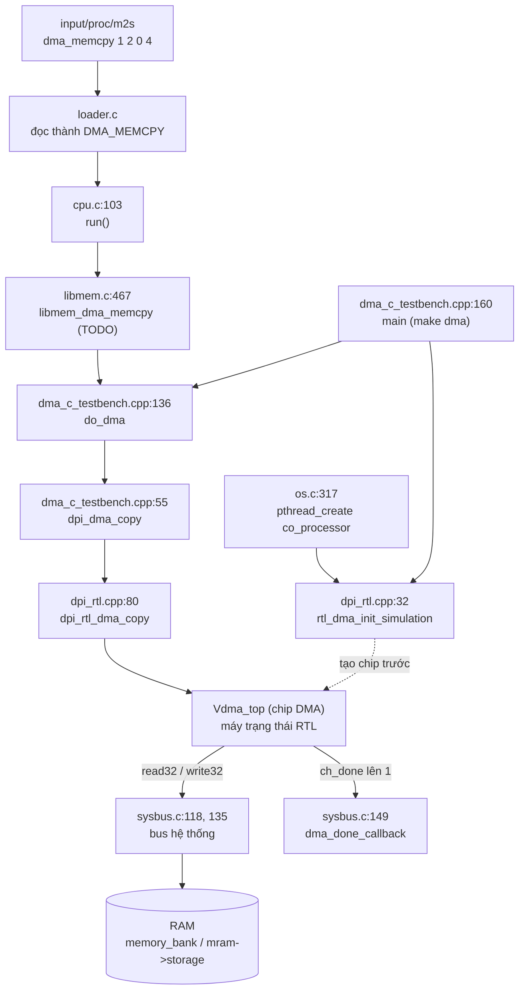
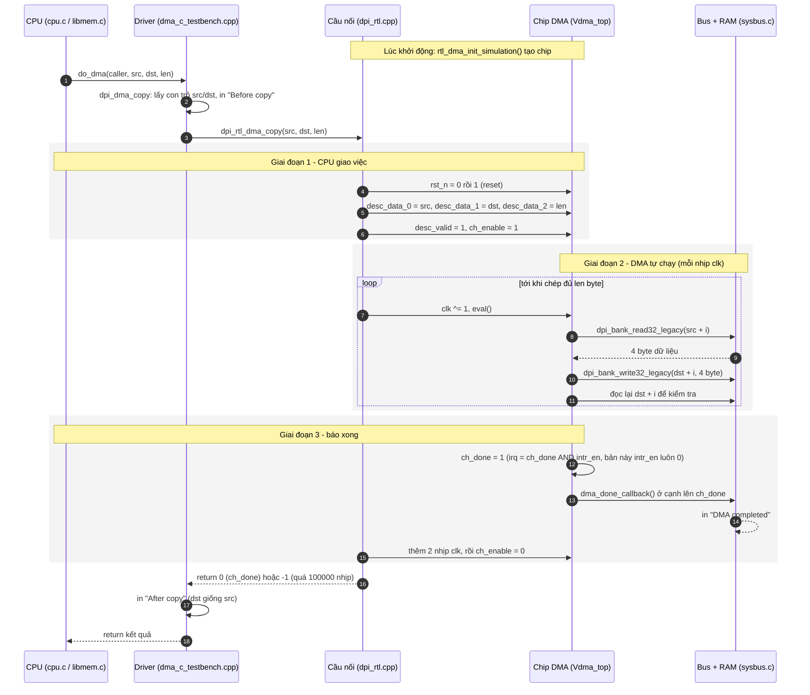

# Sơ đồ luồng DMA (A5 / B5)

Ghi chú tự vẽ khi đọc `dma_c_testbench.cpp`, `sysbus.c`, `dpi_rtl.cpp` và hàm `do_dma`.
Mọi đường dẫn bên dưới tính từ `hk261_ossim_demacOprx/`.

## 1. Các file có liên quan

| Tầng | File | Hàm / phần liên quan | Vai trò | Trạng thái |
|---|---|---|---|---|
| Chương trình | `input/proc/m2s`, `input/os_2_*` | lệnh `dma_memcpy 1 2 0 4` | Tiến trình yêu cầu chép bằng DMA | có sẵn |
| Loader | `src/loader.c:16, 37, 100` | `OPT_DMA_MEMCPY` | Đọc chữ `dma_memcpy` thành lệnh `DMA_MEMCPY` + 4 tham số | có sẵn |
| Lệnh | `include/common.h:60` | `enum ins_opcode_t` | Khai báo opcode `DMA_MEMCPY` | có sẵn |
| CPU | `src/cpu.c:103` | `run()` | Gặp `DMA_MEMCPY` thì gọi `libmem_dma_memcpy` | có sẵn |
| Thư viện | `src/libmem.c:467`, `include/libmem.h:27` | `libmem_dma_memcpy` | Đổi vùng nhớ (rgid) ra địa chỉ vật lý, gọi `do_dma`, xử lý báo xong | **TODO (A5)** |
| Kernel | `src/os.c:121, 317` | `co_processor`, `pthread_create(dma, …)` | Luồng riêng để khởi tạo chip DMA (`rtl_dma_init_simulation`) | có khung, phần callback **TODO** |
| Kernel | `src/os.c:151` | `ld_routine` | Cấp `krnl_pgd` (bảng trang kernel) | có sẵn |
| Driver DMA | `src/dma_c_testbench.cpp:136`, `include/dma.h` | `do_dma` | Cửa vào của DMA cho OS | có, callback **TODO** |
| Driver DMA | `src/dma_c_testbench.cpp:55` | `dpi_dma_copy` | Lấy con trỏ src/dst, in trước/sau, gọi chip | nhánh OS (`mram->storage`) **TODO** |
| Driver DMA | `src/dma_c_testbench.cpp:160` | `main` (chỉ khi `DMA_MAIN=1`) | Testbench độc lập `./dma_testbench` | có sẵn |
| Cầu nối RTL | `src/dpi_rtl.cpp:32`, `include/dpi_rtl.h` | `rtl_dma_init_simulation` | Tạo chip `Vdma_top`, mở `rtl_trace.vcd` | có sẵn |
| Cầu nối RTL | `src/dpi_rtl.cpp:80` | `dpi_rtl_dma_copy` | Reset, ghi descriptor, bật `ch_enable`, quay clock tới `ch_done` | có sẵn |
| Chip DMA | `src/Vdma_top*.cpp`, `include/Vdma_top*.h` | máy trạng thái (Verilator sinh ra) | Tự đọc 4 byte nguồn, ghi 4 byte đích, lặp tới hết | thầy cho sẵn, **không sửa** |
| Bus + RAM | `src/sysbus.c:34, 97` | `memory_bank_init`, `memory_bank_get_ptr` | RAM giả 1 MB cho testbench | có sẵn |
| Bus + RAM | `src/sysbus.c:118, 135` | `dpi_bank_read32_legacy`, `dpi_bank_write32_legacy` | Chip gọi ngược ra C để đọc/ghi RAM theo **offset vật lý** | có sẵn |
| Báo xong | `src/sysbus.c:149` | `dma_done_callback` | In `DMA completed` khi `ch_done` lên 1 | có sẵn |
| Build | `Makefile` | `make dma` (`DMA_MAIN=1`), `make all` (`DMA_MAIN=0`) | Cùng 1 file testbench, 2 chế độ | có sẵn |

Chỗ chip gọi ngược ra C (code Verilator sinh, chỉ để tra cứu):
`src/Vdma_top___024root__DepSet_hbdce0907__0.cpp:140` (đọc), `:144` (ghi + đọc lại kiểm tra), `:334` (gọi `dma_done_callback` ở **cạnh lên** của `ch_done`).

## 2. Bản đồ gọi hàm giữa các file



## 3. Luồng theo thời gian: CPU giao việc, DMA chạy, callback báo xong



## 4. Bản ASCII (dùng khi không xem được Mermaid)

```
 CPU (cpu.c -> libmem.c)        Chip DMA (Vdma_top)              Bus + RAM (sysbus.c)
   |                                 |                                  |
   | 1. GIAO VIỆC                    |                                  |
   |  do_dma -> dpi_dma_copy         |                                  |
   |  -> dpi_rtl_dma_copy:           |                                  |
   |     desc = {src, dst, len} ---->|                                  |
   |     ch_enable = 1 ------------->|                                  |
   |                                 |                                  |
   | 2. DMA CHẠY  (quay clk)         |-- read32(src+i) ---------------->|
   |                                 |<------------------ 4 byte -------|
   |                                 |-- write32(dst+i, 4 byte) ------->|
   |                                 |   ... lặp tới hết len ...        |
   |                                 |                                  |
   | 3. BÁO XONG                     | ch_done = 1                      |
   |                                 |-- dma_done_callback() ---------->| in "DMA completed"
   |<-- return 0 --------------------|                                  |
```

## 5. Hai ý cần nhớ khi vấn đáp

- **Định địa chỉ Bus:** CPU đọc ghi bằng địa chỉ ảo, phải qua MMU và bảng trang 5 cấp.
  DMA chỉ nhận **offset vật lý** (`src`, `dst`) và đi thẳng qua `sysbus.c` tới RAM, không tra bảng trang.
  Vì vậy `libmem_dma_memcpy` phải tự đổi vùng nhớ ra địa chỉ vật lý trước khi gọi `do_dma`.
- **Bất đồng bộ:** đúng ra CPU giao descriptor xong là đi làm việc khác, DMA xong thì báo lại.
  Chip có chân `irq = ch_done AND intr_en` (`src/Vdma_top___024root__DepSet_hbdce0907__0.cpp:367`), nhưng bản thầy cho luôn đặt `intr_en = 0`,
  nên tín hiệu báo xong thật sự dùng được là `dma_done_callback()`.
  Code hiện tại vẫn **đồng bộ**: `dpi_rtl_dma_copy` tự quay vòng `while (cycle < max_cycles && !top->ch_done)` (`src/dpi_rtl.cpp:118`), CPU phải đứng chờ.
  Làm cho nó bất đồng bộ là phần TODO trong `co_processor` (`src/os.c:121`) và `libmem_dma_memcpy` (`src/libmem.c:467`).
